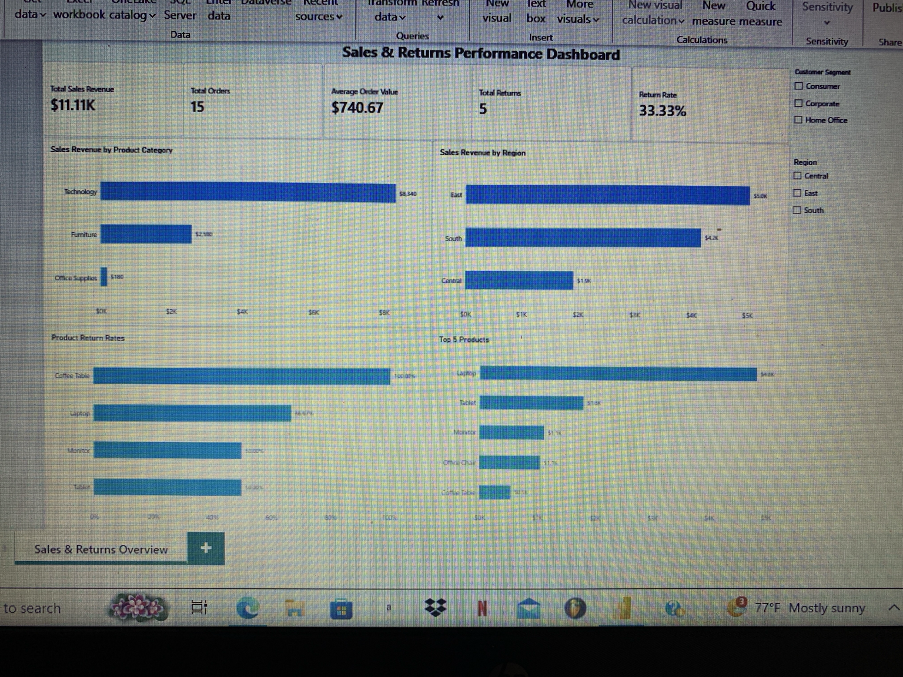

# Sales & Returns Performance Dashboard

## Project Overview

This Power BI project analyzes sales performance and product returns using a retail 
dataset. The dashboard provides an interactive overview of revenue, order activity,
customer segments, regional performance, and product return rates.

The project demonstrates my ability to use Power BI, DAX, data modeling, and SQL
knowledge to transform transactional data into actionable business insights.

## Key Performance Indicators

| KPI | Value |
|---|---:|
| Total Sales Revenue | $11,110 |
| Total Orders | 15 |
| Average Order Value | $740.67 |
| Total Returns | 5 |
| Return Rate | 33.33% |

These metrics provide an overview of sales performance, order value, and product returns across the retail dataset.

## Key Business Findings

1. **Technology Leads Sales:** Technology generated $8,340 in revenue, accounting for approximately 75.1% of total sales. This makes it the strongest-performing product category.

2. **Regional Sales Performance:** The East region generated the highest sales revenue, followed by the South and Central regions.

3. **Product Return Rates:** Coffee Table had a 100% return rate (1 of 1 order), while Laptop had a 66.67% return rate (2 of 3 orders). These results identify products worth investigating, although the small number of orders limits broader conclusions.

4. **Sales Concentration:** Laptop was the highest-revenue product, generating approximately $4,800 in sales.

5. **Business Recommendation:** Investigate the reasons behind product returns, particularly for high-revenue products, and monitor return rates as additional order data becomes available.

Technical Skills & Tools
Power BI Desktop: Developed an interactive sales and returns dashboard featuring KPI cards, bar charts, and slicers.
DAX: Created measures to calculate total revenue, total orders, average order value, total returns, and return rates.
Data Modeling: Established relationships between customers, orders, products, and returns tables.
SQL: Applied relational database and SQL knowledge to understand transactional data and analyze sales performance.
Data Visualization: Designed charts comparing revenue across product categories, regions, and individual products.
Business Intelligence: Identified sales trends, evaluated product return rates, and developed recommendations based on analytical findings.
Interactive Reporting: Implemented Customer Segment and Region slicers to support filtered analysis.

## Dashboard Features

- Five KPI cards: Total Sales Revenue, Total Orders, Average Order Value, Total Returns, and Return Rate.
- Sales Revenue by Product Category bar chart.
- Sales Revenue by Region bar chart.
- Product Return Rates bar chart.
- Top 5 Products bar chart.
- Interactive Customer Segment and Region slicers.

## Project Files

- `Sales_Returns_Analytics_Dashboard.pbix` — Power BI report containing the data model, DAX measures, and interactive dashboard.
- `README.md` — Project overview, performance metrics, business findings, and technical documentation.

## Dataset

This project uses a small synthetic retail dataset containing four related tables: customers, orders, products, and returns. Results are intended to demonstrate analytical techniques rather than represent actual business 

## Dashboard Preview

